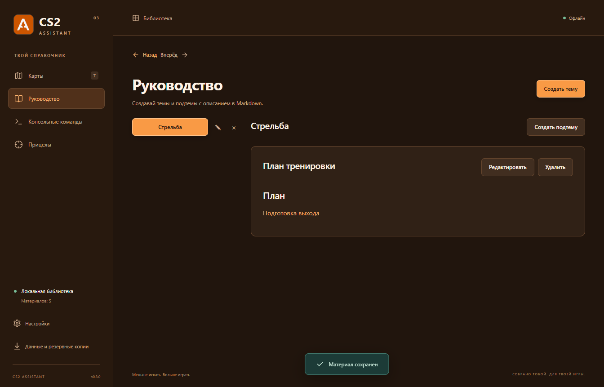

# CS2 Assistant

Личный офлайн-справочник Counter-Strike 2 для Windows. Материалы по картам, раскиды, руководство, команды и прицелы в одном приложении. Без сервера, аккаунта и облачной базы. При первом запуске библиотека пустая.

**[Скачать версию 0.5.0 для Windows](https://github.com/Rockky666/cs2-assistant/releases/tag/v0.5.0)** — файл `CS2-Assistant-0.5.0-portable.exe`. Установка и Node.js не нужны. Библиотека работает офлайн, просмотр YouTube требует интернета. Библиотека хранится в профиле Windows, а не рядом с EXE. Новая версия использует существующие данные автоматически.


## Возможности

- Семь карт: Dust 2, Mirage, Nuke, Ancient, Inferno, Anubis, Cache. Карточки с фотографиями, обычные и альтернативные схемы позиций доступны офлайн. Для Ancient предоставлена только основная схема.
- Смоки, HE, флешки, молотовы, позиции, тактики, полезные фишки и свои категории на каждой карте.
- У гранаты есть название, откуда/куда, способ броска, скриншоты и Markdown-заметки. У флешек достаточно позиции и прицеливания; результат необязателен. Все изображения можно добавлять, переставлять и удалять.
- Способ броска отображается снизу по центру скриншота прицеливания белым текстом с красной обводкой, в том числе при увеличении. Исходное изображение не меняется.
- **Раскиды:** общая позиция и несколько вариантов с целью, способом броска, прицеливанием и результатом. Варианты можно переставлять и удалять. Отдельная необязательная обложка используется на карточке; без неё остаётся прежнее превью.
- Над списком категории отображаются только её теги со счётчиками материалов. Нажатие выбирает точный тег, «Все теги» сбрасывает фильтр. Поиск работает внутри выбранного фильтра; возврат из материала восстанавливает выбор.
- **Видео:** при создании или редактировании материала можно указать ссылку YouTube. Плеер появляется внизу материала, без автозапуска. Поддерживаются обычные ссылки, youtu.be, Shorts, трансляции и время начала. Если встраивание запрещено автором, есть кнопка открытия на YouTube.
- Закрепление материалов вверху списка.
- **Руководство:** свои темы («Стрельба», «Пики» и другие), внутри каждой — множество Markdown-подтем. Создание, предпросмотр, редактирование и удаление. Удаление темы вместе с подтемами требует подтверждения.
- **Внутренние ссылки:** кнопка «Вставить ссылку» в Markdown-редакторе ищет материалы по названию, карте, категории и тегам, а также подтемы руководства. Ссылка сохраняет ID и работает после переименования. «Назад»/«Вперёд» восстанавливают экран, поиск и прокрутку. При удалённой цели появляется пояснение. [Подробнее](docs/INTERNAL-LINKS.md).
- Консольные команды с копированием; приложение их не выполняет.
- Прицелы: скриншот и копируемый текст кода без отдельного названия. Формат `CSGO-…` не проверяется; можно хранить и консольные команды. Нужны скриншот и непустой текст до 10 000 символов.
- Пять тем: **чёрная по умолчанию**, синяя, красная, оранжевая и светлая. Новые предоставленные логотипы; чёрная иконка EXE. Зелёная тема удалена.
- Полный интерфейс на русском, английском и португальском; настройки сохраняются после перезапуска.
- Полосы прокрутки скрыты, прокрутка колесом, клавиатурой и касанием сохранена. Исправлено выравнивание изображений карточек с тегами и фокуса поля поиска.
- Полный экспорт/импорт вместе с изображениями, руководством, ссылками, категориями и настройками.



## Поделиться одним материалом

Открой материал и нажми **«Поделиться»** (или значок обмена на карточке). Сохрани файл **`.cs2material`** и отправь его другу. Получатель нажимает **«Импорт материала»** в боковой панели, выбирает файл и подтверждает добавление. У обоих должна быть версия 0.5.0 или новее.

В файл включаются только выбранный материал, его изображения, теги, способы броска и пользовательская категория. Все варианты раскида, отдельная обложка и ссылка на видео сохраняются. Файлы из версии 0.4.0 по-прежнему импортируются; новый формат обмена версии 2 требует приложения 0.5.0 или новее у получателя. Импорт добавляет отдельную копию в нужную карту и категорию, не заменяя библиотеку или настройки. Повторный импорт создаёт ещё одну копию. Категория с тем же названием и типом используется повторно; при конфликте типов создаётся новая с суффиксом.

Другие материалы и подтемы, на которые ссылается Markdown, автоматически не отправляются. Ссылки на отсутствующие у получателя записи покажут сообщение о недоступной цели. Полная резервная копия и файл одного материала — разные форматы; импорт материала не принимает резервную копию.

## Данные и обновление

```text
%APPDATA%\CS2 Assistant\library.json
%APPDATA%\CS2 Assistant\library.json.bak
```

Версия схемы — **4**. Базы версий 1, 2 и 3 читаются с миграцией в памяти: идентификаторы, заметки и изображения сохраняются. У старой зелёной темы выбирается чёрная, остальные существующие темы сохраняются. Чтение не перезаписывает исходный файл; при первом сохранении исходная база попадает в `.bak`. Старые приложения не читают схему 4 — для отката нужна копия старой базы.

Сохранение проверяет схему, записывает временный файл, создаёт копию предыдущей базы и заменяет основной файл. Повреждённая база не заменяется пустой. Импорт проверяется и запрашивает подтверждение полной замены библиотеки. `.bak` хранит только предыдущее состояние; для долгосрочного хранения используйте экспорт в разделе «Данные и резервные копии».

Общий размер базы не ограничен приложением; фактический объём зависит от доступной памяти и места на диске. Лимиты отдельных элементов: 8 МБ на изображение PNG/JPG/WebP, 30 скриншотов обычного материала, 20 вариантов раскида плюс общая позиция и отдельная обложка. До 20 тегов на материал, 200 своих категорий, 100 способов броска, 200 тем и 10 000 подтем руководства. Изображения хранятся в исходном качестве в base64.

Markdown поддерживает заголовки, списки и таблицы; HTML и скрипты не исполняются. Внутренние ссылки открываются только внутри приложения. Внешние Markdown-ссылки остаются текстом, удалённые изображения не загружаются. Видеоплеер загружает YouTube в изолированном iframe только при наличии ссылки; видеофайл не скачивается и не включается в резервную копию. Кнопка GitHub в настройках открывает фиксированный адрес репозитория в браузере. Renderer изолирован, доступ к файловой системе ограничен preload API. Одновременно работает один экземпляр программы.

## Разработка

Нужен Node.js 22.22+; установка зависимостей требует интернета.

```powershell
npm ci
npm start             # собрать и открыть Electron
npm run dev           # браузерный предпросмотр с базой в памяти
npm run check         # тесты данных, TypeScript, production-сборка
npm run test:desktop  # сценарии реального Electron в отдельной базе
npm run dist          # portable EXE в release/
npm run pack          # распакованное приложение
```

Предпросмотр не использует личную библиотеку и теряет данные при перезагрузке. Переменная `CS2_TEST_DATA_DIR` действует только для тестов в режиме разработки. Упаковка выполняется во временной папке Windows, после чего результат копируется в `release/`, чтобы избежать блокировок OneDrive. Сборка не подписана сертификатом разработчика.

GitHub Actions запускает проверки и сборку Windows. Промежуточные сборки доступны в **Actions → Check and build → Artifacts**, опубликованные версии — в **Releases**. EXE не хранится в Git.

## Проверки

Тесты данных покрывают миграции 1/2/3 → 4, резервные копии, связи тем и подтем, уникальность ID, преобразование категорий, необязательный результат флешки и допустимые адреса ссылок.

Проверка Electron использует отдельную временную базу и проверяет создание/редактирование/удаление материалов, теги, закрепления, раскиды, прицелы произвольного формата, буфер обмена, все карты и темы, три языка, перезапуск и полный экспорт/импорт. Дополнительно проверяются руководство, вставка ссылок, переименование цели, отсутствующая цель, цепочки переходов, возврат прокрутки, защита несохранённого текста, выравнивание карточек и фокус поиска. Артефакты — в `output/playwright/`.

## Структура

```text
src/model.ts             Схема данных и миграции
src/App.tsx              Экраны, сохранение и история навигации
src/Guide.tsx            Темы и Markdown-подтемы руководства
src/links.tsx            Внутренние адреса и вставка ссылок
src/Editor.tsx           Редактор материала
src/editor-model.ts      Преобразование категорий
src/MaterialViews.tsx    Карточки, просмотр и схемы карт
src/CollectionEditors.tsx Редакторы команд и прицелов
src/ImageFields.tsx      Загрузка изображений
src/Settings.tsx         Настройки и резервные копии
src/messages.ts         Переводы RU / EN / PT
src/styles.css          Темы и адаптивная вёрстка
electron/               Окно, IPC и хранение
scripts/                Сборка и проверки Electron
tests/                  Тесты данных
public/assets/          Фотографии, карты и логотипы
docs/                   Документация и скриншоты
```
