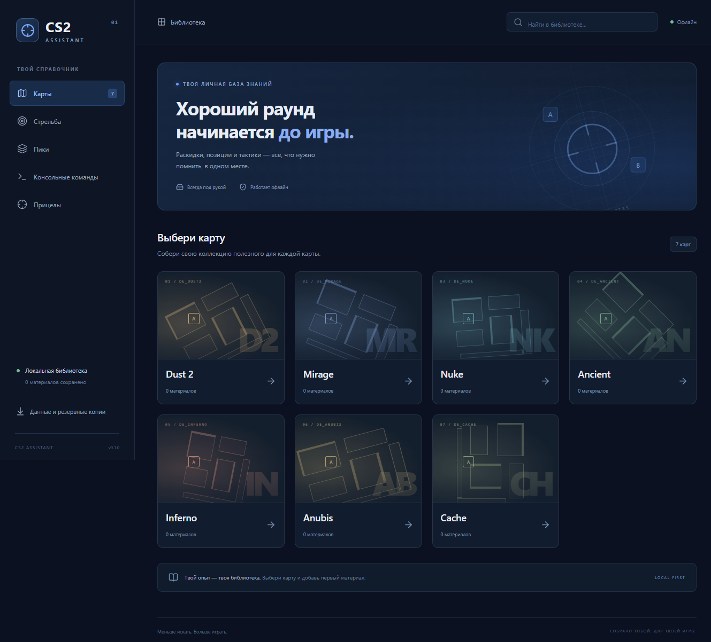

# CS2 Assistant

Личный офлайн-справочник Counter-Strike 2 для Windows. Самостоятельное приложение на Electron + React + TypeScript: без сервера, аккаунта и облачной базы. При первом запуске библиотека пустая — наполнение добавляет пользователь.



## Запуск

Готовая программа: `release/CS2-Assistant-0.1.0-portable.exe` после сборки. Для её запуска Node.js и интернет не нужны. Приложение не требует установки; библиотека хранится в профиле Windows, а не рядом с EXE. Для переноса библиотеки используйте экспорт/импорт.

Запуск из исходников (Node.js 22.22+):

```powershell
npm ci
npm start
```

При первой установке зависимостей и загрузке Electron нужен интернет. `npm start` собирает интерфейс и открывает обычное окно программы, без локального сервера.

Собрать portable EXE:

```powershell
npm run dist
```

После push GitHub Actions также собирает Windows-приложение. Скачать его можно в **Actions → Check and build → Artifacts → CS2-Assistant-Windows**. EXE не хранится в Git. Сборка не подписана сертификатом разработчика.

Упаковка выполняется во временной папке Windows, затем результат копируется в `release/`: это обходит блокировки промежуточных файлов синхронизатором OneDrive.

## Что реализовано

- Карты: Dust 2, Mirage, Nuke, Ancient, Inferno, Anubis, Cache.
- На каждой карте: смоки, HE-гранаты, флешки, молотовы, позиции, тактики и полезные фишки.
- Переходы: карта → категория → карточки → просмотр или редактор.
- Добавление, редактирование и удаление с подтверждением.
- Гранаты: название, откуда/куда, способ броска из списка или свой вариант, скриншоты и дополнительные заметки.
- Три стартовых места для скриншотов, добавление дополнительных, удаление и изменение порядка. На странице материала изображения показаны по порядку и открываются крупно.
- Позиции, тактики и фишки: название, изображения, Markdown с предпросмотром, списками и таблицами.
- Поиск по названию, позициям, способу броска и описанию; на главной — по всей библиотеке, внутри карты/категории — в выбранном разделе.
- Консольные команды: название, текст, копирование, редактирование и удаление. Команды не выполняются приложением.
- Стрельба, пики и прицелы оставлены пустыми разделами согласно ТЗ.
- Тёмный адаптивный интерфейс, навигация с хлебными крошками, предупреждение о несохранённых изменениях.
- Экспорт/импорт всей библиотеки вместе со скриншотами и своими способами броска.

Декоративные схемы на плитках карт условные: это оформление, не игровые радары. Готовых раскидок и другого учебного контента нет.

## Где данные

```text
%APPDATA%\CS2 Assistant\library.json
%APPDATA%\CS2 Assistant\library.json.bak
```

Основная база содержит материалы, команды и изображения в base64. Сохранение: проверка схемы → запись во временный файл → копия предыдущей базы → переименование. При ошибке чтения приложение показывает ошибку и не заменяет базу пустой. Импорт проверяет структуру и просит подтверждение замены. Кнопки резервного копирования находятся в разделе **Данные и резервные копии**.

`library.json.bak` — предыдущая версия, а не история изменений. Для ручного восстановления скопируйте этот файл под именем с расширением `.json` и выберите его при импорте. Для долгосрочного хранения периодически делайте экспорт в отдельную папку.

Ограничения начальной версии: до 30 скриншотов на материал, до 8 МБ на загружаемый PNG/JPG/WebP, база до 100 МБ. Скриншоты хранятся в исходном качестве; base64 увеличивает размер примерно на треть. Для большой коллекции следующим шагом стоит вынести изображения в отдельные файлы и добавить миграцию базы. Одновременно работает один экземпляр приложения.

Markdown не исполняет HTML. Удалённые изображения и переходы по ссылкам отключены: ссылки отображаются как текст, изображения добавляются файлами. Интерфейс не загружает шрифты, карты или иной контент из сети. Renderer изолирован и получает только ограниченные операции через preload, без доступа к Node.js.

## Разработка и проверки

```powershell
npm run dev           # браузерный предпросмотр; данные только в памяти
npm run check         # тесты хранения + TypeScript + production-сборка
npm run test:desktop  # проверка реального Electron в отдельной временной базе
npm run pack          # распакованное приложение в release/win-unpacked
```

Браузерный предпросмотр намеренно не использует личную библиотеку: изменения исчезают при перезагрузке; импорт и экспорт доступны в Electron. Для повседневного использования запускайте EXE или `npm start`.

Тест Electron проверяет CRUD, загрузку четырёх скриншотов, изменение порядка, Markdown, поиск, буфер обмена, перезапуск, экспорт/импорт, отказ от повреждённого импорта, подтверждение удаления и компактную вёрстку. Скриншоты проверок находятся в `output/playwright/` и не попадают в Git. Диалоги выбора файлов в тесте заменяются заданными ответами; IPC, файловое хранение и интерфейс работают настоящие. Переменная `CS2_TEST_DATA_DIR` действует только в режиме разработки.

На момент создания `npm audit --omit=dev` не выявил уязвимостей runtime-зависимостей. Полный аудит сообщает о moderate-уязвимости в транзитивной цепочке инструментов упаковки `electron-builder → @electron/get → global-agent → roarr → sprintf-js`; она не включена в код приложения. Обновление этой цепочки оставлено до совместимого исправления upstream.

## Структура

```text
src/model.ts          Общая схема данных, карты и категории
src/App.tsx           Навигация и экраны библиотеки
src/Editor.tsx        Форма материала, скриншоты и способы броска
src/components.tsx    Markdown и модальные окна
src/storage.ts        Ограниченный мост к Electron / режим предпросмотра
src/styles.css        Тёмная тема и адаптивная вёрстка
electron/main.ts      Окно приложения, IPC, резервные копии, буфер обмена
electron/preload.ts   Публичный API для renderer
electron/storage.ts   Проверка, чтение и атомарная запись базы
tests/                Тесты данных и хранения
scripts/              Сборка Electron и проверка приложения
docs/SPEC.md          Исходное техническое задание
```

Версия схемы — `1`. При расширении формата нужно добавить миграцию перед изменением версии; несовместимые копии сейчас отклоняются.
